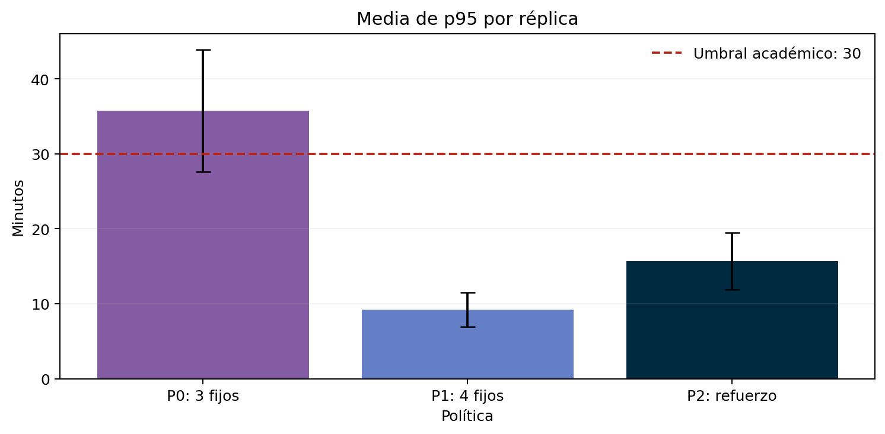
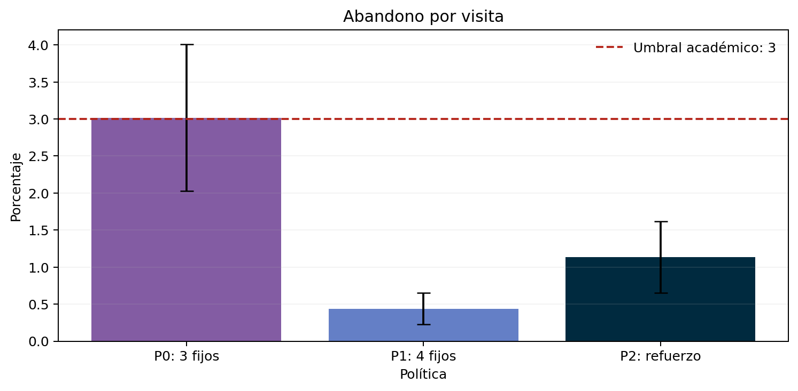
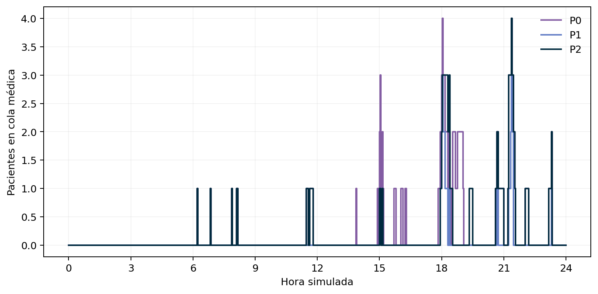
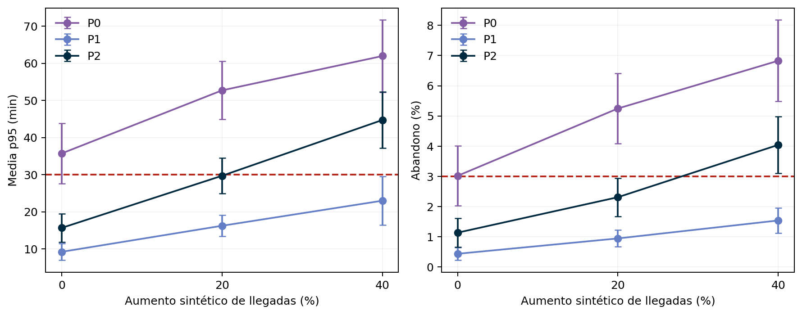
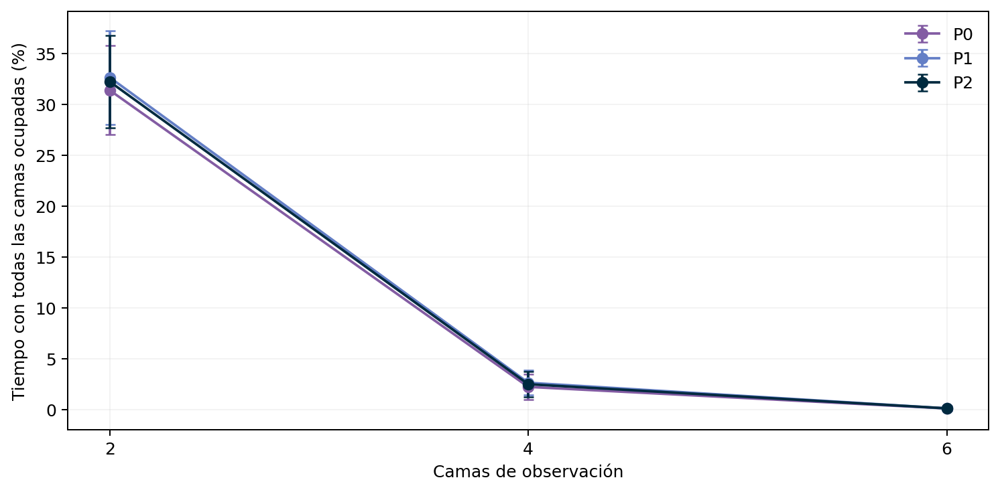

# Informe final de SIMURGENCIAS

## 1. Identificación y resumen ejecutivo

**Curso:** Modelos y Simulación, 2026-2, I.U. Pascual Bravo. **Autor:** Juan Fernando Murillo Mosquera. **Correo institucional:** juan.murillo334@pascualbravo.edu.co. **Modalidad documentada:** individual, pendiente de confirmar con el docente la aplicación del requisito grupal de commits. **Rol ejecutado en esta ampliación:** integración del modelo, experimentación y análisis con apoyo de IA. **Repositorio:** https://github.com/juanferyt/SIMURGENCIAS. **Revisión base:** `a1f2c193d957c56f7d593a46b2ac6cd29f0245df`. Los cambios entregados son posteriores a esa revisión y aún no tienen SHA final publicado.

**Despliegue:** `docker compose up --build -d`. **Experimentos:** `docker compose -f docker-compose.final.yml run --build --rm experiments`.

SIMURGENCIAS estudia un servicio de urgencias sintético con recursos finitos. Compara tres médicos fijos, cuatro fijos y un refuerzo durante el pico. En 30 réplicas nominales por política, el refuerzo obtiene una media de p95 de 15,66 minutos y abandono del 1,14%, con 78,02 horas médicas/día. Reduce las horas un 18.72% frente a cuatro médicos fijos y satisface los criterios académicos nominales. Con mayor demanda pierde robustez. Se recomienda para el escenario nominal y cuatro médicos como alternativa de capacidad bajo crecimiento, condicionada a revalidación. Los experimentos son locales y reproducibles. La nueva versión requiere comprobar Docker/PostgreSQL antes de la entrega formal.

## 2. Contexto del sistema y subsanación de la Entrega 1

La entidad es una visita de un paciente sintético. El recorrido comprende llegada, triage, cola priorizada, consulta, observación opcional y egreso. Los recursos son un puesto de triage, médicos equivalentes y cuatro camas. La prioridad es no expulsiva: un paciente más urgente puede adelantar a quienes esperan, pero no interrumpe una consulta iniciada. La cola de espera es ilimitada; no existe rechazo clínico por aforo en este experimento.

El límite físico hospitalario se representa por las camas: ninguna corrida puede ocupar más camas que las configuradas. Al terminar consulta se libera el médico antes de esperar cama, coherente con el motor original. Esa decisión permite que observación acumule su propia cola sin bloquear médicos. La API conserva otro límite independiente: dos simulaciones admitidas por proceso, con respuesta HTTP 429 si no hay plaza. Este límite informático no cuenta pacientes.

Para modelar comportamiento C7, las visitas de prioridad académica IV–V tienen paciencia exponencial de media 180 minutos en la cola médica. Si abandonan, pueden regresar 60 minutos después con probabilidad 0,30 y un reintento máximo. Cada retorno conserva el identificador de persona y añade un número de intento. Generados cuenta visitas; personas externas y visitas de retorno se publican por separado. Estos valores son supuestos experimentales y no normas clínicas.

| Limitación documentada o brecha respecto a la guía | Ampliación realizada | Evidencia |
|---|---|---|
| Modelo sin abandonos ni retornos | Paciencia, cancelación de solicitudes y retorno acotado | `backend/app/simulation/engine.py`, `domain.py` |
| Dotación fija durante el día | Refuerzo con retiro no expulsivo y cómputo de horas reales | `engine.py`, `test_final_delivery.py` |
| Sin política elegida por costo y servicio | Comparación P0/P1/P2 y sensibilidad | `scripts/final_experiments.py` |
| Telemetría sin latencia/RAM HTTP por petición | CSV con estado, latencia, RSS y CPU acumulada | `backend/app/request_telemetry.py` |
| Resultados de Entrega 1 sin estudio final | 810 corridas operativas y 60 referencias | `docs/final_results/manifest.json` |
| Falta de informe en seis secciones | Este documento y figuras enlazadas | `docs/INFORME_FINAL.md` |

La tabla identifica limitaciones y ampliaciones propias. La guía no incluye a SIMURGENCIAS en el diagnóstico de los cinco grupos, por lo que no se atribuyen al docente observaciones dirigidas a otros proyectos. Tampoco se consideran errores los componentes excluidos expresamente del alcance inicial.

## 3. Arquitectura del prototipo, telemetría y calibración de parámetros

React/TypeScript solicita corridas a FastAPI. El servicio ejecuta el mismo motor SimPy utilizado por los experimentos, guarda configuración y resultado en PostgreSQL mediante SQLAlchemy y produce snapshots. Docker Compose declara PostgreSQL, backend y frontend. La ampliación conserva las rutas de integración y añade parámetros opcionales de turnos y comportamiento, disponibles en el contrato de Swagger. La interfaz histórica mantiene su configuración predeterminada sin abandono ni refuerzo.

La medición nueva ejecutó 100 peticiones secuenciales a `/api/theory/mmc` mediante el transporte ASGI local. La latencia de cliente media fue 2.06 ms, p95 2.48 ms y p99 2.71 ms. El CSV registra RAM RSS entre 69.02 y 69.88 MiB y CPU acumulada del proceso. CPU acumulada no es utilización porcentual. La sonda no abrió conexión PostgreSQL ni ejecutó lifespan, TCP o contenedores. No estima capacidad máxima ni concurrencia. Es evidencia del endpoint y middleware locales; Docker y persistencia de esta revisión siguen pendientes de ejecución. La evidencia histórica de contenedores permanece identificada como Entrega 1.

| Entrada | Distribución o regla | Unidad | Procedencia |
|---|---|---|---|
| Llegadas externas | Poisson por tramos, λ=2/5/9/6 | pacientes/h | Supuesto sintético de Entrega 1 |
| Duración de cada franja | Determinista, seis horas | h | Diseño experimental |
| Triage | Exponencial, media 5 | min | Supuesto sintético |
| Consulta | Exponencial, media 18 | min | Supuesto sintético |
| Observación | Bernoulli p=0,20 y duración exponencial media 60 | probabilidad/min | Supuesto sintético |
| Prioridad I–V | Categórica, probabilidades 0,05/0,15/0,40/0,25/0,15 | categoría | Supuesto sintético |
| Paciencia IV–V | Exponencial, media 180 | min | Supuesto de ampliación |
| Retorno | Bernoulli 0,30, demora 60, máximo un retorno | probabilidad/min | Supuesto de ampliación |
| Refuerzo P2 | Un médico adicional de 12:00 a 18:00 | h | Política experimental |

Las latencias informáticas no calibran tiempos de triage o consulta. No se afirma calibración hospitalaria. La parametrización completa queda en cada corrida nominal comprimida y los hashes de fuentes figuran en el manifiesto. No se cambian tasas para obtener un resultado favorable.

## 4. Diseño experimental y validación analítica

La jornada operativa dura 1.440 minutos, inicia vacía y termina sin vaciar colas. Se informa el número de pacientes pendientes y la espera incompleta al cierre. No se elimina calentamiento en este experimento transitorio. La referencia estacionaria usa otro diseño: 14.400 minutos de calentamiento y 144.000 minutos de observación, más seguimiento de la cohorte hasta terminar. El calentamiento reduce el transitorio inicial, sin probar que lo elimina exactamente.

Se utilizan 30 réplicas independientes por configuración, semillas 42–71. Los flujos aleatorios de llegadas y atributos se separan mediante claves SHA-256. Los atributos externos se generan al llegar, de forma que modificar la capacidad conserva las realizaciones de entrada. Paciencia y retornos usan claves de persona e intento independientes del generador externo. Esto permite diferencias emparejadas entre políticas sin alterar las llegadas externas cuando aparecen reintentos.

El estudio operativo cruza tres políticas, factores de demanda 1,00/1,20/1,40 y 2/4/6 camas: 27 configuraciones y 810 corridas. El escenario nominal comprende 90 corridas, 30 por política con cuatro camas. Se añaden 60 referencias M/M/c: tres y cuatro servidores con 30 semillas cada uno.

El contraste aislado utiliza entrada Poisson constante, consulta exponencial, FIFO y espera ilimitada, sin triage, observación, prioridad, abandonos ni turnos. Con λ=9/h y μ=60/18 por hora, ρ=λ/(cμ) toma 2,70, 1,35, 0,90 y 0,675 para uno a cuatro médicos. Uno y dos no tienen medias estacionarias finitas. Una corrida finita puede terminar aun cuando la aproximación estacionaria sea inestable.

| Médicos | Métrica | M/M/c | SimPy, media ± IC95% | Error relativo (%) |
|---|---|---|---|---|
| 3 | rho | 0.9000 | 0.9015 ± 0.0037 | 0.16 |
| 3 | Lq | 7.3535 | 7.6164 ± 0.4141 | 3.57 |
| 3 | Wq | 49.0237 | 50.7291 ± 2.6841 | 3.48 |
| 3 | W | 67.0237 | 68.7501 ± 2.7130 | 2.58 |
| 4 | rho | 0.6750 | 0.6761 ± 0.0028 | 0.17 |
| 4 | Lq | 0.8115 | 0.8330 ± 0.0232 | 2.66 |
| 4 | Wq | 5.4097 | 5.5504 ± 0.1479 | 2.60 |
| 4 | W | 23.4097 | 23.5714 ± 0.1629 | 0.69 |

El error relativo es 100×abs(SimPy−teoría)/abs(teoría). Las diferencias de muestreo y los bordes de ventana explican discrepancias pequeñas; no constituyen una prueba de equivalencia universal. Las identidades de Little incluyen aportes de pacientes anteriores o posteriores al corte. En el modelo completo, sistema y cola incluyen las salidas por abandono para conservar el balance; las esperas medias de atendidos se mantienen separadas.

Los IC95% emplean la media de réplicas y t(0,975;29)=2,04523 con desviación muestral. Son intervalos marginales aproximados, no garantías individuales ni bandas simultáneas. Los percentiles intrarréplica usan interpolación tipo 7. El promedio de esos percentiles da igual peso a cada jornada y difiere del percentil de todos los pacientes agrupados.

## 5. Resultados y evaluación de políticas de decisión

Se fijaron antes de ejecutar dos umbrales académicos: media de p95 por réplica ≤30 minutos y abandono medio por visita ≤3%. Como criterio conservador adicional se exige que el límite superior de cada IC95% marginal también quede por debajo. Estos objetivos no representan regulación sanitaria, ni aseguran cumplimiento para cada prioridad o cada jornada.

| Política | Dotación | Horas nominales/día |
|---|---|---|
| P0 | Tres médicos permanentes | 72 |
| P1 | Cuatro médicos permanentes | 96 |
| P2 | Tres permanentes y uno de 12:00–18:00 | 78 |

| KPI | Umbral académico | P0, media ± IC95% | P1, media ± IC95% | P2, media ± IC95% |
|---|---|---|---|---|
| Espera media (min) | Descriptivo | 6.79 ± 1.56 | 1.52 ± 0.40 | 2.99 ± 0.73 |
| Media p95 intrarréplica (min) | ≤30 | 35.72 ± 8.14 | 9.21 ± 2.27 | 15.66 ± 3.77 |
| Media p99 intrarréplica (min) | Descriptivo | 68.17 ± 15.78 | 21.11 ± 5.07 | 37.90 ± 9.82 |
| Abandono/visitas (%) | ≤3 | 3.02 ± 0.99 | 0.44 ± 0.21 | 1.14 ± 0.48 |
| Lq (pacientes) | Descriptivo | 0.78 ± 0.22 | 0.15 ± 0.04 | 0.33 ± 0.12 |
| Utilización médica (%) | Descriptivo | 53.11 ± 2.29 | 40.80 ± 1.88 | 49.64 ± 2.25 |
| Egresos/h | Descriptivo | 5.39 ± 0.16 | 5.54 ± 0.18 | 5.47 ± 0.17 |
| Pendientes al cierre | Descriptivo | 5.17 ± 1.17 | 4.30 ± 0.78 | 5.13 ± 1.13 |
| Cola médica al cierre | Descriptivo | 0.80 ± 0.68 | 0.07 ± 0.14 | 0.77 ± 0.62 |
| Horas médicas/día | Minimizar sujeto a SLA | 72.00 ± 0.00 | 96.00 ± 0.00 | 78.02 ± 0.03 |

P0 excede ambos umbrales nominales de media. P1 y P2 satisfacen además la comprobación mediante límites superiores marginales. P2 reduce la media de p95 un 56.16% frente a P0. El incremento de horas desde P0 es de aproximadamente seis por día. Frente a P1, ahorra 17,98 horas médicas/día, equivalentes al 18.72%.

Las horas reales de P2 superan ligeramente las 78 nominales porque el fin de turno no interrumpe una consulta en curso. La utilización usa capacidad-tiempo realmente disponible. El criterio económico principal son horas de recurso, con tarifa horaria uniforme supuesta. No se presentan precios reales, ahorros en pesos ni valoración monetaria de desenlaces clínicos. Si la hora de refuerzo tiene recargo, la conclusión económica debe recalcularse.

Las esperas de pacientes que iniciaron atención excluyen a quienes siguen esperando o abandonaron, por lo que deben interpretarse junto con abandonos y pendientes. Los reintentos pueden hacer que una persona produzca dos visitas. Las tablas no suman atendidos y egresados como poblaciones independientes.

Con demanda +20%, P2 alcanza una media de p95 de 29,70 minutos; aunque queda bajo 30 en la estimación puntual, su IC superior rebasa el umbral. Con +40%, la media de p95 llega a 44,72 minutos y el abandono al 4,04%. P1 mantiene el criterio conservador en los escenarios estudiados de cuatro camas, incluido +40%. Esa evidencia no autoriza extrapolar a cualquier nivel de demanda.

La sensibilidad de camas muestra el efecto sobre ocupación completa y espera de observación. Como el modelo libera al médico antes de solicitar cama, aumentar camas no necesariamente mejora la espera de consulta. La recomendación depende de esa arquitectura del flujo. Debe estudiarse bloqueo médico si el alcance futuro cambia la regla de transferencia.

## 6. Conclusión de ingeniería y declaración de uso de IA

Para la demanda nominal sintética y con tarifa uniforme por hora médica, P2 ofrece el menor consumo de horas entre las políticas estudiadas que satisfacen el criterio conservador de espera y abandono. P1 obtiene menor espera y mayor margen ante aumentos de demanda, a costa de 96 horas/día. P0 no satisface los umbrales. La decisión final es condicional al escenario: refuerzo en pico para la demanda nominal y reevaluación de cuatro médicos ante crecimiento, evitando presentar el refuerzo como una solución robusta a +20% de llegadas.

La validez externa es limitada por entradas sintéticas, inicio vacío, paciencia supuesta, una sola regla de prioridad y ausencia de bloqueo médico por camas. Los promedios diarios ocultan diferencias por franja o prioridad. El estudio no determina contratación de un hospital real. Antes de la entrega formal deben ejecutarse Docker y las pruebas PostgreSQL de esta revisión, obtener el SHA del commit final que contenga código y documentos.

| Herramienta de IA | Uso en esta ampliación | Verificación realizada y pendiente |
|---|---|---|
| ChatGPT/Codex | Cambios del motor, pruebas, scripts, síntesis y presentación | 31 pruebas independientes de PostgreSQL, 870 corridas, conservación y trazabilidad de fuentes. Pendiente defensa personal del autor y validación Docker/PostgreSQL |

La ejecución científica produjo archivos reales y no tablas inventadas. Los comandos, semillas, configuraciones, datos por réplica y hashes permiten revisar los resultados. La asistencia de IA no sustituye la comprensión del estudiante ni su defensa individual. Los cambios de esta ampliación se entregan como archivos locales para incorporar al repositorio; el enlace público de la revisión base no contiene automáticamente estas modificaciones.
