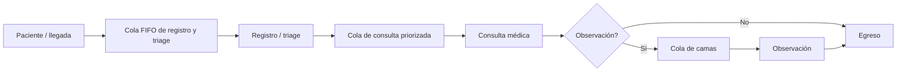

# Modelo DES y análisis

## Dominio, eventos y unidades

Unidad interna: minuto; llegada configurada en pacientes/hora y convertida a pacientes/minuto. Reloj inicial: 00:00. Sistema inicialmente vacío. El horizonte predeterminado es 1440 minutos, máximo 10080. Se ejecutan eventos con tiempo menor al horizonte, conforme a `Environment.run(until=H)`; los que ocurren exactamente en H no se procesan.

`SimulationConfig` valida entradas y rechaza campos desconocidos, valores no finitos, tasas negativas o un perfil sin ninguna llegada posible. `Patient` conserva requerimientos y marcas de tiempo. `Doctor` encapsula la capacidad y el `PriorityResource`; `TriageStation` el `Resource` de triage; `EmergencyDepartment` coordina los generadores. `SimulationResult` contiene métricas y evidencia por paciente.



Tres etapas de servicio: registro/triage, consulta y observación opcional. La consulta libera el médico antes de esperar cama. Ningún recurso es infinito: triage y camas son `Resource`, médicos `PriorityResource`. No hay vacaciones de personal ni interrupción de consulta. El registro está incluido en el tiempo de triage, no como estación separada.

## Prioridad y distribuciones

Niveles I–V con pesos sintéticos 5/15/40/25/15 %. Menor entero significa mayor prioridad. Es una abstracción académica **sin interpretación de protocolo clínico**. La prioridad aplica a pacientes esperando médico, no al triage. No interrumpe un servicio ya iniciado; los empates siguen el orden de solicitud.

Servicios exponenciales independientes, medias por defecto: triage 5 min, consulta 18 min, observación 60 min. Probabilidad de observación: 0.2. No hay abandono; `abandoned=0` es un supuesto, no un resultado de abandono validado.

## Strategy

| Abstracción | Implementaciones | Punto de inyección |
|---|---|---|
| `ArrivalStrategy` | `TimeVaryingArrivalStrategy`, `StationaryArrivalStrategy` | `EmergencyDepartment(arrival=...)` |
| `TriageStrategy` | `PriorityTriageStrategy`, `FifoTriageStrategy` | `EmergencyDepartment(triage=...)` |
| `ServiceTimeStrategy` | `ExponentialServiceStrategy` | `EmergencyDepartment(service=...)` |

El núcleo consume `next_delay`, `priority` y `sample`, sin conocer las implementaciones inyectadas. Las pruebas inyectan servicio determinista y comprueban orden de atención.

Llegadas principales: proceso de Poisson no homogéneo por franjas de seis horas que se repiten cada día. Tasas sintéticas: 2, 5, 9, 6 por hora. Se extrae riesgo exponencial unitario y se consume la integral de la tasa atravesando los límites de franja. Esto respeta periodos de tasa cero y evita prolongar una tasa antigua más allá de su franja.

## Reproducibilidad y escenarios

Dos generadores locales `random.Random` con claves SHA256 derivadas de (semilla, rol), esquema `sha256-v1`. El modo histórico `legacy-v1` conserva seed/seed+1 solo para reproducir corridas antiguas. Cada paciente recibe **todos** sus requerimientos al llegar, incluso su posible tiempo de observación. La capacidad no cambia el orden de extracción; 1–4 médicos reciben los mismos pacientes y demandas. Cambia la cronología de atención. Mismos parámetros/semilla/versiones → resultados numéricos idénticos; UUID, fecha y tiempo de cómputo no son reproducibles por diseño.

Una corrida por escenario no implica inferencia estadística ni superioridad garantizada de cada media en todas las semillas: las medias de completados tienen poblaciones distintas. No se ofrece recomendación médica.

## Definición de métricas

| Salida | Definición y población |
|---|---|
| generated | Llegadas antes de H |
| treated | Consultas terminadas antes de H; puede quedar observación pendiente |
| discharged | Egresos antes de H |
| active_at_end | Pacientes aún dentro al corte |
| mean_wait_minutes | Entrada a consulta menos fin de triage, solo quienes iniciaron consulta |
| mean_triage_wait_minutes | Inicio de triage menos llegada, solo quienes iniciaron triage |
| mean_system_minutes | Egreso menos llegada, solo egresados |
| mean_service_minutes | Duración de consulta, solo consultas finalizadas |
| mean_queue_length | Integral de longitud de cola médica / H |
| mean_triage_queue_length | Integral de cola de triage / H |
| mean_observation_queue_length | Integral de cola de camas / H |
| doctor_utilization | Integral de médicos ocupados / (H × médicos) |
| triage_utilization | Integral de triage ocupado / (H × personal de triage) |
| bed_utilization | Integral de camas ocupadas / (H × camas) |
| mean_active | Integral de pacientes presentes / H |

Sin observaciones de la población relevante se devuelve `null`, no un cero ficticio. Las áreas se actualizan antes de cada cambio de estado y una última vez en H. La serie visual tiene hasta aproximadamente 721 puntos; **no se usa para calcular las áreas**. La utilización incluye servicio parcial antes del corte, sin contabilizar trabajo posterior.

Conservación: `generated = discharged + active_at_end`. `treated` y `discharged` se solapan: no deben sumarse.

## M/M/c

Para una cola aislada: tasa λ estacionaria, servicio exponencial con μ = 1/media, servidores idénticos, FIFO, población y sala de espera ilimitadas, independencia y régimen estacionario. Se exige ρ = λ/(cμ) < 1. Erlang C calcula P(esperar); Wq = P(esperar)/(cμ−λ), W = Wq+1/μ, Lq=λWq y L=λW. El cálculo usa recurrencias y evita factoriales grandes. Si ρ ≥ 1 devuelve `stable=false`, motivo y métricas nulas.

Para llegadas variables no se presenta una equivalencia M/M/c ni se usa silenciosamente una tasa promedio diaria. Para el perfil estacionario, se presenta una **referencia nominal aislada de consulta**, con Wq, Lq y diferencias respecto al DES. Sigue sin equivaler al DES completo: triage transforma la entrada, puede haber prioridad y el horizonte parte vacío y es finito. `compatible=false` hace explícita esa diferencia. La calculadora independiente sí evalúa el modelo teórico bajo los supuestos indicados.

## Little y censura en el corte

Sea H el horizonte, N los egresos y W la permanencia media de esos egresados. Se muestra λ observado=N/H, L observado=área de todos los pacientes presentes/H y λW.

Por conservación de área, con sistema inicialmente vacío:

```text
L observado = (suma de permanencias de egresados + suma de (H − llegada) de pendientes) / H
L observado − λW = suma de (H − llegada) de pendientes / H
```

Se reporta el segundo término como `censored_contribution` y se prueba su igualdad numérica. No es apropiado afirmar convergencia estacionaria a partir de una corrida no estacionaria. Si no hay egresos, W y λW se dejan nulos y el aporte censurado sigue disponible.

## Límites

No hay datos reales, calibración, atención clínica, abandonos, mortalidad, derivación, bloqueo del médico esperando cama, cambios de turno, calentamiento en el modelo principal. El script académico ejecuta réplicas e IC95%; la referencia FIFO usa warm-up explícito. Son extensiones posibles, no funcionalidades ocultas de esta entrega. La prioridad I–V es académica y no garantiza tiempos clínicos de respuesta.
