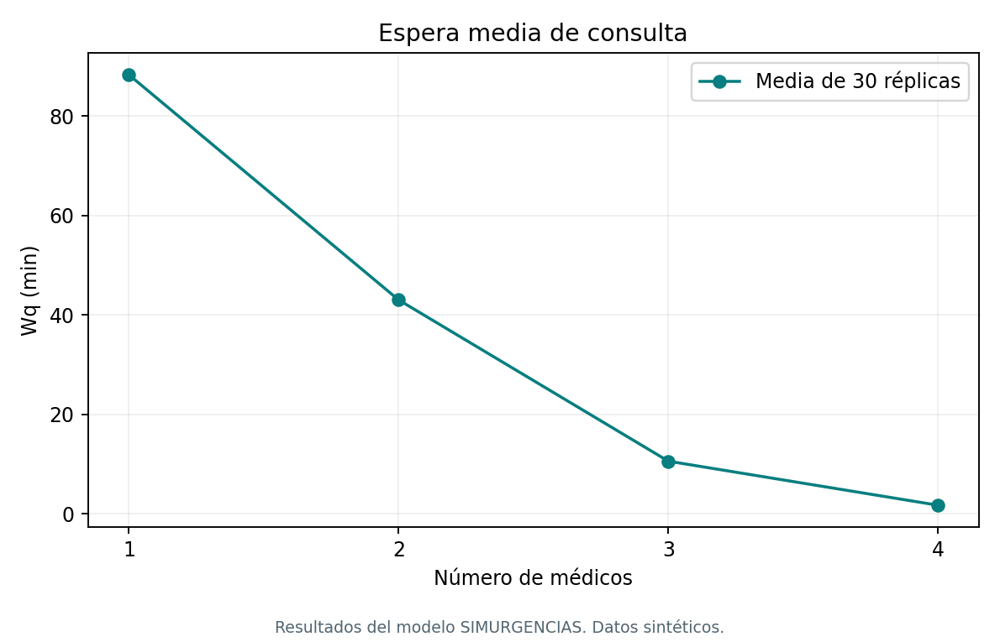
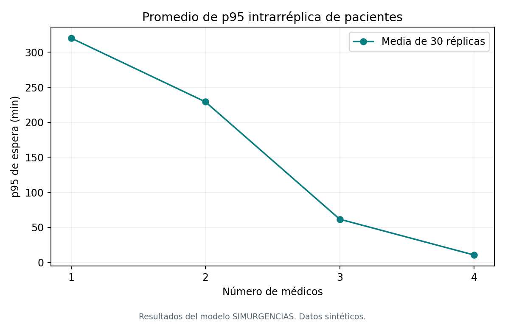
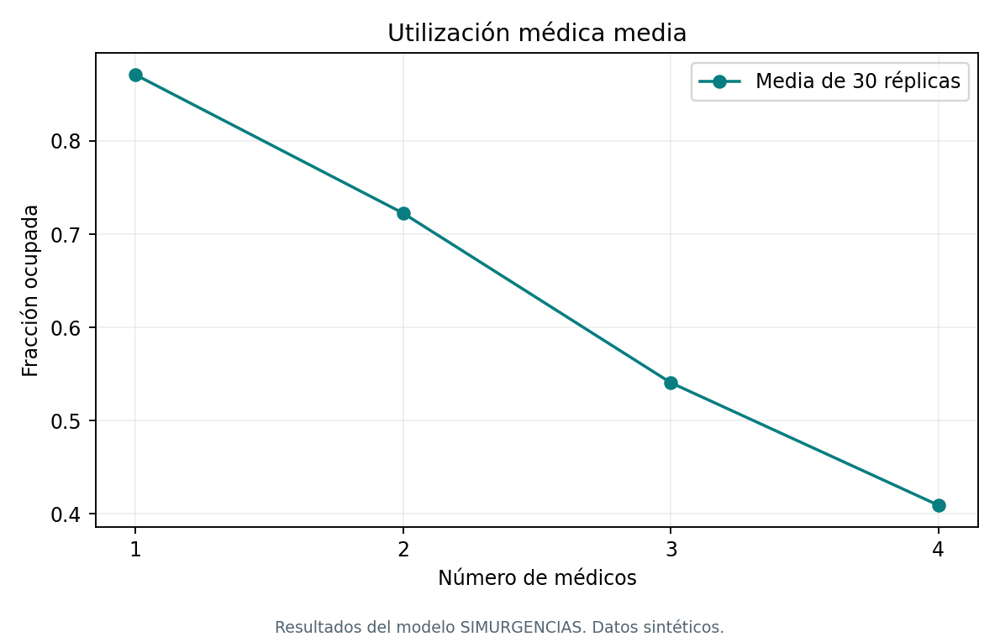
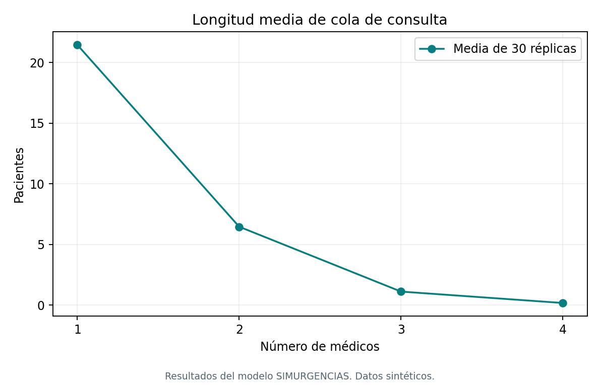
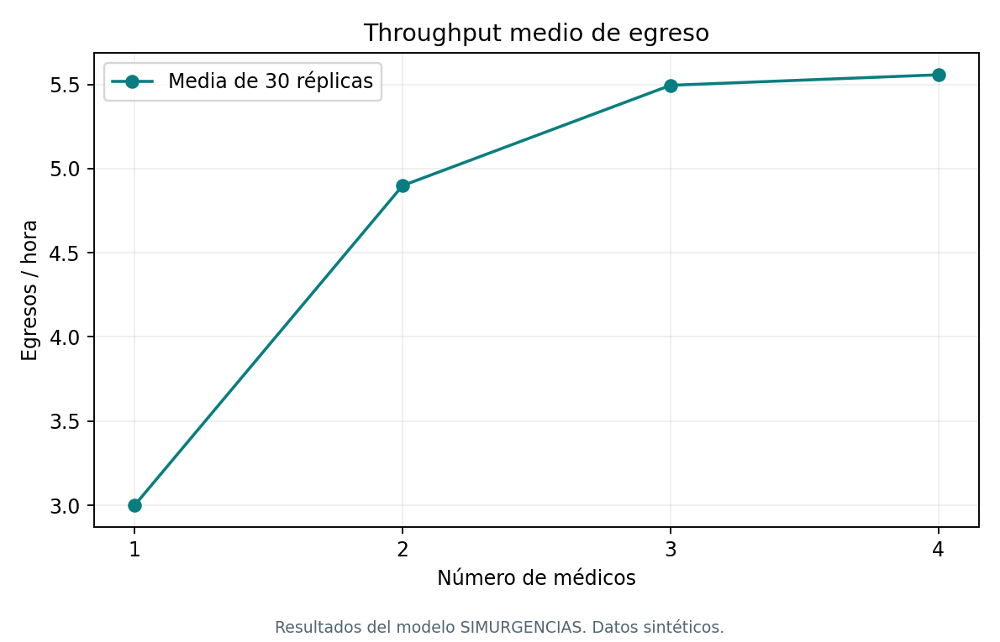
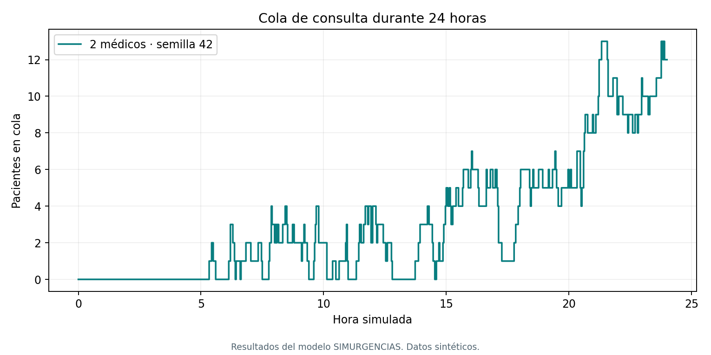
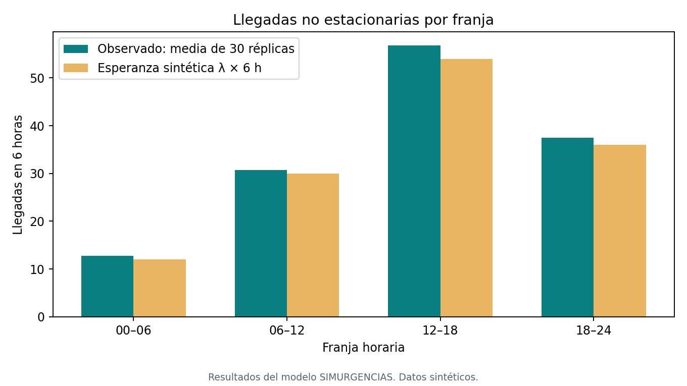
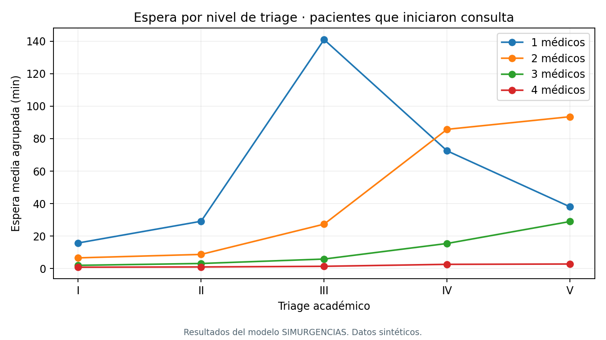

# Resultados de auditoría final · SIMURGENCIAS · Entrega 1

Auditoría experimental: 2026-10-01T06:53:29.123639+00:00 (UTC). Datos sintéticos. Todos los valores de este informe proceden de ejecuciones de esta auditoría, no de las evidencias previas.

## A. Configuración experimental

Se ejecutaron **120 corridas del modelo completo**, 30 para cada c=1,2,3,4. Semillas 42–71, comunes entre escenarios para comparación emparejada. Horizonte 1440 min, sistema vacío, sin calentamiento ni drenaje. Triage=1, camas=4, llegadas 2/5/9/6 por hora en cuatro franjas de 6 h, servicios exponenciales con medias 5/18/60 min, observación 0.2 y prioridad I–V no expropiativa.

La API conserva el modo interactivo de una réplica por escenario. Las 120 réplicas académicas se ejecutan con el mismo motor mediante scripts y se guardan en archivos, sin crear 120 atenciones de gestión.

Esquema actual sha256-v1: clave por (semilla, rol). La compatibilidad legacy-v1 ya existía antes de esta auditoría. No se modificaron motor, fórmulas, semillas ni resultados para esta entrega. Las secuencias distintas sustentan réplicas independientes operacionalmente; no prueban independencia estadística.

## B. Reproducibilidad

Dos corridas completas con semilla 42: igualdad exacta **True**. Cambio a 100: métricas distintas **True**. Entradas individuales idénticas entre los cuatro escenarios para cada semilla: **True**.

| Semilla | Generados | Atendidos | Egresados | Wq (min) | p95 (min) | Throughput (egresos/h) |
|---|---|---|---|---|---|---|
| 42 | 144 | 130 | 130 | 21.6129 | 97.0931 | 5.4167 |
| 100 | 143 | 119 | 117 | 32.8554 | 140.5519 | 4.8750 |

[Configuración y métricas completas](results/reproducibilidad.json). Los UUID, fechas y tiempo de cómputo de la API no son variables reproducibles y no se confunden con el resultado DES.

## C–D. Comparación 1–4 médicos y tabla de KPI

Cada valor es la media aritmética de 30 estadísticas de réplica. **p95** significa aquí media de los 30 percentiles 95 de esperas de pacientes, no percentil 95 de las 30 medias. Cola máxima es la media de máximos exactos por réplica. Unidades: tiempos en minutos, colas en personas, throughput en egresos/hora. Los conteos medios pueden ser fraccionarios.

| c | Wq | p95 espera | W | Lq | Cola máx. media | Util. % | Throughput | Atendidos | Egresados | Pendientes |
|---|---|---|---|---|---|---|---|---|---|---|
| 1 | 88.33 | 320.25 | 123.97 | 21.458 | 63.80 | 87.11 | 3.000 | 72.57 | 72.00 | 65.70 |
| 2 | 43.05 | 229.21 | 81.34 | 6.461 | 23.67 | 72.25 | 4.899 | 118.73 | 117.57 | 20.13 |
| 3 | 10.61 | 61.66 | 50.33 | 1.113 | 9.33 | 54.05 | 5.494 | 133.17 | 131.87 | 5.83 |
| 4 | 1.75 | 10.56 | 41.58 | 0.173 | 4.23 | 40.91 | 5.557 | 134.63 | 133.37 | 4.33 |

[Tabla maestra CSV](results/escenarios_1_4_medicos.csv) · [JSON](results/escenarios_1_4_medicos.json) · [120 filas por réplica](results/repeticiones_120.csv) · [Pacientes y series originales comprimidos](results/hospital_runs.json.gz).

La espera Wq y sus percentiles incluyen a quienes iniciaron consulta. W incluye solo egresados. Quienes siguen esperando al corte no tienen una espera final observada; se reportan en los pendientes y en Little. Una media menor no describe automáticamente a todos los pacientes.

### Dispersión entre réplicas

| c | Wq media | Wq mediana | DE muestral | Mín. | Máx. | p95 de las 30 medias |
|---|---|---|---|---|---|---|
| 1 | 88.332 | 83.129 | 27.782 | 44.886 | 138.237 | 133.906 |
| 2 | 43.048 | 38.442 | 22.260 | 10.598 | 100.338 | 82.827 |
| 3 | 10.611 | 6.904 | 9.234 | 1.966 | 36.097 | 28.994 |
| 4 | 1.751 | 1.314 | 1.409 | 0.283 | 5.928 | 4.197 |

Se usa desviación estándar muestral (n−1). Media, mediana, DE, mínimo, máximo y p95 de todas las métricas están en [estadisticos_por_escenario.json](results/estadisticos_por_escenario.json).

### Tres percentiles que no son intercambiables

| c | Media de p95 de pacientes por réplica | p95 de pacientes agrupados | p95 de medias Wq de réplica |
|---|---|---|---|
| 1 | 320.2486 | 346.6218 | 133.9061 |
| 2 | 229.2072 | 221.9588 | 82.8274 |
| 3 | 61.6628 | 51.8136 | 28.9941 |
| 4 | 10.5552 | 10.7109 | 4.1969 |

Percentiles empíricos con interpolación lineal tipo 7, posición (n−1)p. El agrupado pondera implícitamente por cantidad de pacientes atendidos de cada réplica; la media de percentiles da peso igual a cada réplica. También se registran p50, p99 y probabilidad de espera (Wq > 10⁻⁹ min) por corrida.

## E. Gráficas reales

















La serie temporal usa c=2, semilla 42, elegida de antemano. Está muestreada para visualización; las medias y la cola máxima no se estiman a partir de esa muestra.

## F. M/M/c analítico

λ=9 pacientes/h=0.15/min; servicio medio=18 min; μ=60/18=3.333333 pacientes/h por servidor. ρ=λ/(cμ). La función calcula P0 por normalización y Pq mediante Erlang C. Wq=Pq/(cμ−λ), W=Wq+1/μ, Lq=λWq, L=λW.

| c | ρ | Estado | P0 | Pq | Lq | Wq (min) | W (min) | L |
|---|---|---|---|---|---|---|---|---|
| 1 | 2.700 | INESTABLE | No definido | No definido | No definido | No definido | No definido | No definido |
| 2 | 1.350 | INESTABLE | No definido | No definido | No definido | No definido | No definido | No definido |
| 3 | 0.900 | ESTABLE | 0.0249 | 0.8171 | 7.3535 | 49.0237 | 67.0237 | 10.0535 |
| 4 | 0.675 | ESTABLE | 0.0573 | 0.3907 | 0.8115 | 5.4097 | 23.4097 | 3.5115 |

Para c=1 y c=2 no existe distribución estacionaria normalizable ni medias estacionarias finitas. No se atribuyen valores finitos a esas métricas. [Resultados analíticos](results/mmc_analitico.json). Fórmula contrastada con [material académico de MIT sobre colas](https://web.mit.edu/dimitrib/www/Queueing_Data_Nets.pdf).

## G. Referencia SimPy compatible

**60 corridas adicionales:** c=3 y c=4, 30 semillas 42–71 para cada una. Una única cola FIFO, Resource con c servidores, Poisson estacionario, servicio exponencial, sin triage, prioridad ni observación. Código: `backend/app/simulation/reference.py`. El modelo completo no se cambia por este experimento.

Se eligió antes de ejecutar una ventana larga: 14400 min (10 días) de warm-up y 144000 min (100 días) de observación. Las áreas de ocupación y cola se recortan exactamente a esa ventana. W y Wq usan la cohorte que llega durante la ventana, seguida hasta completar servicio. Se drena esa cohorte después del corte, sin contaminar las áreas temporales. En FIFO, las llegadas posteriores al corte no retrasarían a esa cohorte.

El warm-up reduce el efecto de partir vacío, sin demostrar que lo elimina. No se seleccionaron semillas ni se ajustó el horizonte después de ver los errores. [60 réplicas de referencia](results/mmc_repeticiones_60.csv).

## H. M/M/c frente a SimPy y diferencias

| c | Métrica | Teoría | SimPy medio | Diferencia absoluta | Diferencia % | DE entre réplicas |
|---|---|---|---|---|---|---|
| 3 | rho | 0.900000 | 0.901472 | 0.001472 | 0.164 | 0.009966 |
| 3 | Lq | 7.353549 | 7.616424 | 0.262875 | 3.575 | 1.108926 |
| 3 | Wq | 49.023661 | 50.729065 | 1.705403 | 3.479 | 7.188150 |
| 3 | W | 67.023661 | 68.750079 | 1.726418 | 2.576 | 7.265597 |
| 3 | L | 10.053549 | 10.320839 | 0.267290 | 2.659 | 1.131507 |
| 4 | rho | 0.675000 | 0.676117 | 0.001117 | 0.166 | 0.007499 |
| 4 | Lq | 0.811453 | 0.833041 | 0.021588 | 2.660 | 0.062020 |
| 4 | Wq | 5.409684 | 5.550351 | 0.140667 | 2.600 | 0.396092 |
| 4 | W | 23.409684 | 23.571365 | 0.161682 | 0.691 | 0.436289 |
| 4 | L | 3.511453 | 3.537510 | 0.026057 | 0.742 | 0.079058 |

Diferencia % = |SimPy−teoría| / |teoría| × 100. No se calcula si el denominador es cero o indefinido. ρ es una fracción, L/Lq personas y W/Wq minutos. [CSV del contraste](results/mmc_vs_simpy.csv).

Los errores relativos observados van de 0.164 % a 3.575 %. No se presentan como tolerancia garantizada ni como prueba estadística de equivalencia.

Las diferencias son compatibles con una observación finita y variable de un sistema aleatorio: treinta réplicas no eliminan el error muestral, las tasas y medias realizadas difieren de los parámetros nominales y los bordes de la ventana introducen términos medibles. A ρ=0.9 la variabilidad de la cola es mayor que con cuatro servidores. La DE entre réplicas se publica; no se ocultan valores desfavorables ni se atribuye automáticamente la diferencia a un defecto de SimPy.

El DES completo puede diferir mucho más porque tiene llegadas no estacionarias, salida de triage como entrada a consulta, prioridades, varias etapas, observación y pacientes pendientes al cierre. Su comparación interactiva estacionaria sigue siendo solo una referencia nominal, no este contraste compatible.

## I. Ley de Little: sistema y cola

Para el modelo completo: λ=egresos/H y W=permanencia de egresados. L integra a todos los presentes. Se verifica L−λW=Σ(H−llegada de pendientes)/H. Para consulta, λq=inicios de consulta/H y Wq=espera de quienes iniciaron; Lq−λqWq=Σ(H−entrada a cola de quienes siguen esperando)/H. Las dos tasas tienen poblaciones distintas y no se intercambian.

| c (seed 42) | L | λ egreso/min | W | λW | Residuo | Aporte pendientes |
|---|---|---|---|---|---|---|
| 1 | 27.541175 | 0.050000 | 96.745598 | 4.837280 | 22.703895 | 22.703895 |
| 2 | 7.119773 | 0.090278 | 64.408024 | 5.814613 | 1.305160 | 1.305160 |
| 3 | 4.465517 | 0.098611 | 44.734360 | 4.411305 | 0.054212 | 0.054212 |
| 4 | 4.303957 | 0.099306 | 43.194129 | 4.289417 | 0.014540 | 0.014540 |

| c (seed 42) | Lq | λ inicios/min | Wq | λWq | Residuo | Aporte pendientes cola |
|---|---|---|---|---|---|---|
| 1 | 24.538156 | 0.051389 | 58.840955 | 3.023771 | 21.514384 | 21.514384 |
| 2 | 3.100747 | 0.091667 | 21.612886 | 1.981181 | 1.119566 | 1.119566 |
| 3 | 0.218866 | 0.100000 | 2.188659 | 0.218866 | 0.000000 | 0.000000 |
| 4 | 0.050910 | 0.100000 | 0.509099 | 0.050910 | -0.000000 | 0.000000 |

En las 120 corridas, máximo error de la identidad de sistema: 3.908e-14; de cola: 2.842e-14. La magnitud es compatible con redondeo de coma flotante. [Tabla completa de Little](results/little_modelo_completo.csv).

En la referencia con warm-up hay además pacientes que ingresaron antes de la ventana. La identidad exacta es área temporal = área de la cohorte + aporte de entrada − aporte posterior al corte. Se verificó para L y Lq en las 60 corridas. No se fuerza L=λW ignorando esos bordes. [Little de referencia](results/little_referencia.csv).

## J. Llegadas no estacionarias

Se cuentan las marcas de llegada del motor completo, usando c=2 y las 30 semillas. No se cuadruplican las llegadas al agregar escenarios emparejados.

| Franja | λ configurada /h | Conteo esperado por 6 h | Conteo medio observado | λ observada /h |
|---|---|---|---|---|
| 00–06 | 2 | 12 | 12.733 | 2.122 |
| 06–12 | 5 | 30 | 30.700 | 5.117 |
| 12–18 | 9 | 54 | 56.767 | 9.461 |
| 18–24 | 6 | 36 | 37.500 | 6.250 |

Las diferencias frente a las esperanzas son variación de muestreo, no tasas cambiadas para ajustar el resultado. La mayor demanda aparece efectivamente en 12–18 h. [Conteos y tasas](results/llegadas_por_franja.csv) · [Por semilla](results/llegadas_por_franja_replicas.csv).

## K. Límite técnico C6

Con MAX_CONCURRENT_SIMULATIONS=2, tres solicitudes HTTP coordinadas mediante bloqueo transaccional real en PostgreSQL produjeron **2 respuestas 201 y 1 respuestas 429**. Todas las 429 incluyeron Retry-After=2; al terminar active_simulations=0 y una solicitud posterior fue admitida. [Evidencia HTTP](results/api_audit.json).

A y B ejecutan SimPy real y esperan al guardar por un bloqueo SHARE temporal sobre simulation_runs. Se observa active_simulations=2 y C recibe 429. El bloqueo se libera siempre con rollback y A/B reciben 201. Una transacción PostgreSQL READ ONLY causa el error real SQLSTATE 25006 en la ruta simulate; active vuelve a 0 y la plaza puede reutilizarse. No se reemplazan el motor ni las respuestas para esta evidencia. El test unitario aislado preexistente usa una barrera y se conserva como cobertura complementaria.

**Límite técnico de admisión de simulaciones por proceso**, cola interna de espera=0. No es capacidad hospitalaria, prueba de rendimiento máximo ni componente formal de carga de Entrega 2. El servidor HTTP y su threadpool pueden tener esperas propias fuera de este semáforo.

## L. Hallazgos que deben discutirse

Bajo los parámetros sintéticos utilizados, las medias de Wq, p95, Lq y pendientes disminuyen al aumentar médicos. El throughput crece, pero de 3 a 4 médicos lo hace menos: se aproxima al límite impuesto por la demanda y otras etapas. Esta observación se refiere al modelo y a las 30 semillas, no a una dotación hospitalaria óptima.

Resultado no monotónico por prioridad que se conserva: con un médico, triage V tiene menor espera observada que III. Eso no demuestra mejor atención de V. Solo 70 de sus 604 pacientes iniciaron consulta, frente a 1077 de 1648 en III; 534 pacientes V aún no iniciaban. Con dos médicos empiezan 338 pacientes V, incluyendo esperas largas antes censuradas: su media observada sube. La selección de pacientes completados/iniciados cambia entre escenarios.

| c | Triage | Generados | Iniciaron | No iniciaron | Wq de iniciados | p95 de iniciados |
|---|---|---|---|---|---|---|
| 1 | 3 | 1648 | 1077 | 571 | 141.009 | 406.634 |
| 1 | 4 | 1028 | 247 | 781 | 72.509 | 220.334 |
| 1 | 5 | 604 | 70 | 534 | 38.005 | 181.638 |
| 2 | 3 | 1648 | 1591 | 57 | 27.354 | 117.599 |
| 2 | 4 | 1028 | 857 | 171 | 85.743 | 397.784 |
| 2 | 5 | 604 | 338 | 266 | 93.518 | 426.514 |

La utilización de un médico no llega a 100 % en todo el día pese a la cola acumulada: hay un arranque vacío y una franja inicial de menor demanda. Medir solo horas congestionadas produciría otra definición.

## M. Limitaciones y conclusión

Modelo académico sin datos hospitalarios ni validación clínica; sin abandono, bloqueo médico esperando cama, cambios de turno o calentamiento en el modelo completo. Las esperas censuradas no se imputan. Los percentiles de muestra no son garantías de servicio. El contraste largo reduce transitorios pero no prueba estacionariedad exacta ni error universal. Se calculan IC95% t de las medias de réplica; no inferencia bayesiana ni KS.

La API de gestión es una demo local sin autenticación y con una atención por paciente. La telemetría de gestión interpreta etapas registradas, no asignaciones reales de médicos. Contadores técnicos en memoria se reinician al reiniciar el proceso; snapshots y resultados guardados permanecen en PostgreSQL. La interfaz interactiva conserva una réplica por escenario; el lote académico de 30 está en scripts y archivos.

Git: git status y git log -1 --oneline fallan porque no existe .git. Se guardó el estado previo en results/previous-audit/ y hashes en final-audit-before.json; la ejecución usa Python 3.12.14 en Docker.

**ENTREGA 1: LISTA PARA ENTREGAR**, en su alcance académico y con las limitaciones anteriores. La matriz C1–C7 y el detalle de pruebas están en [ENTREGA_1.md](ENTREGA_1.md) y [VERIFICACION.md](VERIFICACION.md). No se implementaron Locust, PyMC, KS, ML, Mesa, agentes, modelo híbrido ni predictor.

## Reproducir los resultados

Desde la raíz, con Docker activo:

```powershell
docker compose up --build -d
docker compose -f docker-compose.yml -f docker-compose.audit.yml build audit
docker compose -f docker-compose.yml -f docker-compose.audit.yml run --rm --no-deps audit python /workspace/scripts/audit_api.py
docker compose -f docker-compose.yml -f docker-compose.audit.yml run --rm --no-deps audit python /workspace/scripts/audit_experiments.py
docker compose -f docker-compose.yml -f docker-compose.audit.yml run --rm --no-deps audit python /workspace/scripts/audit_report.py
```

Las ejecuciones siguientes regeneran los archivos de resultados con los mismos valores numéricos si versiones/esquema/semillas coinciden; fechas, tiempos de cómputo, UUID y orden de respuesta concurrente pueden cambiar. Se recomienda conservar una copia de `docs/results/` antes de volver a auditar si se necesita guardar cada ejecución histórica.

## N. Intervalos de confianza 95% de las medias

n=30; t(0.975,29)=2.045229642132703; IC = media ± t × s / sqrt(30), con s muestral (n−1). Son intervalos marginales por escenario, no intervalos de pacientes ni de diferencias emparejadas. No se deduce significación de comparar su solapamiento. Su cobertura es aproximada bajo independencia entre réplicas y aproximación de la media; no se efectuó KS ni se ajustaron parámetros.

| c | Métrica | Media | DE | IC inferior | IC superior |
|---|---|---|---|---|---|
| 1 | mean_wait_minutes | 88.332320 | 27.781836 | 77.958412 | 98.706228 |
| 1 | mean_queue_length | 21.458415 | 5.684859 | 19.335654 | 23.581177 |
| 1 | doctor_utilization | 0.871054 | 0.049807 | 0.852456 | 0.889652 |
| 1 | throughput_per_hour | 3.000000 | 0.317701 | 2.881369 | 3.118631 |
| 2 | mean_wait_minutes | 43.048463 | 22.260005 | 34.736440 | 51.360485 |
| 2 | mean_queue_length | 6.461118 | 3.983828 | 4.973532 | 7.948703 |
| 2 | doctor_utilization | 0.722497 | 0.055480 | 0.701780 | 0.743214 |
| 2 | throughput_per_hour | 4.898611 | 0.430890 | 4.737714 | 5.059508 |
| 3 | mean_wait_minutes | 10.610659 | 9.233619 | 7.162769 | 14.058549 |
| 3 | mean_queue_length | 1.112970 | 1.015968 | 0.733601 | 1.492339 |
| 3 | doctor_utilization | 0.540549 | 0.063531 | 0.516826 | 0.564271 |
| 3 | throughput_per_hour | 5.494444 | 0.462654 | 5.321687 | 5.667202 |
| 4 | mean_wait_minutes | 1.751476 | 1.409127 | 1.225299 | 2.277652 |
| 4 | mean_queue_length | 0.172683 | 0.147837 | 0.117480 | 0.227887 |
| 4 | doctor_utilization | 0.409055 | 0.051251 | 0.389917 | 0.428192 |
| 4 | throughput_per_hour | 5.556944 | 0.505180 | 5.368307 | 5.745582 |

Las utilizaciones de esta tabla son fracciones (multiplicar por 100 para porcentaje). Archivo: [intervalos_confianza_95.csv](results/intervalos_confianza_95.csv).

## O. Cambios de capacidad

| Cambio | Reducción Wq min | Reducción Wq % | Cambio p95 min | Cambio Lq | Cambio utilización pp | Cambio egresos/h |
|---|---|---|---|---|---|---|
| 1 → 2 | 45.2839 | 51.2653 | -91.0414 | -14.9973 | -14.8557 | 1.8986 |
| 2 → 3 | 32.4378 | 75.3518 | -167.5444 | -5.3481 | -18.1948 | 0.5958 |
| 3 → 4 | 8.8592 | 83.4932 | -51.1076 | -0.9403 | -13.1494 | 0.0625 |

Bajo los parámetros sintéticos del experimento, pasar de 3 a 4 médicos reduce espera y utilización, mientras el throughput aumenta solo 0.0625 egresos/h. No existe una función de costos ni un objetivo de optimización que permita declarar automáticamente mejor el escenario de cuatro médicos.

## P. Telemetría y persistencia comprobadas

La respuesta real contiene timestamp, management, technical y simulations (plural). Cada corrida produce un snapshot source=simulation con ID; consultar telemetría persiste un snapshot source=management. simulation_runs, pacientes, atenciones y snapshots sobreviven al reinicio. El GET de telemetría tiene ese efecto de escritura documentado.

| Medida | Antes del reinicio | Después |
|---|---|---|
| completed_simulations | 8 | 0 |
| rejected_simulations | 1 | 0 |
| active_simulations | 0 | 0 |
| requests_processed | 74 | 3 |

Los contadores técnicos son memoria del proceso y vuelven a cero; solicitudes de health/telemetría pueden incrementarlos inmediatamente. Corrida recuperada idéntica: True. [Evidencia de reinicio](results/restart_validation.json).

## Q. Auditoría de KPI y unidades

| KPI | Fórmula/población | Unidad | Censura |
|---|---|---|---|
| Wq | media(inicio consulta − fin triage), solo inicios | min | No imputa la espera final de pendientes |
| p95 | tipo 7, posición (n−1)×0.95 de las esperas individuales | min | Misma población que Wq |
| W | media(egreso − llegada), solo egresados | min | Excluye permanencias inconclusas |
| Lq | integral exacta de cola / H | pacientes | Incluye tiempo acumulado de quienes esperan al corte |
| Utilización | integral ocupación / (c×H) | fracción | Incluye servicio parcial antes de H |
| Throughput | egresados / (H/60) | egresos/h | No confunde consultas terminadas con egresos |
| 429 | solicitud que no adquiere plaza técnica | respuesta HTTP | No cuenta pacientes ni rechazo clínico |

test_kpis_reconstructed_from_individual_records reconstruye Wq, W, cuantiles, Lq, utilización, probabilidad de espera y throughput desde los registros. Conservación: generados = egresados + pendientes. Atendidos = consultas terminadas, y no se suman a egresados.

## R. Triage y alcance del contrato

La API sí aporta triage_end y consultation_start por paciente: el script científico calcula correctamente la espera por triage desde esas observaciones. La ausencia de agregados en el frontend no impide el análisis fuera de él. Se generó 08_espera_por_triage.png, solo para pacientes que iniciaron consulta; los no iniciados se publican como censurados.

## S. Validaciones finales

| Comando | Código de salida |
|---|---|
| docker compose down (sin -v); docker compose up --build -d; docker compose ps | 0 |
| docker compose exec -T backend pytest -q | 0 |
| docker compose exec -T backend python -m compileall -q app | 0 |
| docker compose exec -T backend alembic current | 0 |
| npm --prefix frontend run build | 0 |
| npm --prefix frontend test | 0 |
| audit: python /workspace/scripts/verify_notebook.py | 0 |
| audit: python /workspace/scripts/audit_experiments.py | 0 |
| audit: python /workspace/scripts/audit_api.py | 0 |
| audit_restart.py before; docker compose restart backend; audit_restart.py after | 0 |

La evidencia de prioridad no expropiativa preexistente obtuvo (inicio,fin): paciente 1=(0.5,10.5), paciente 3 urgente=(10.5,11.5), paciente 2 esperando=(11.5,12.5). El urgente no interrumpió al primero.

## T. Hallazgos corregidos y pendientes

Corregidos: documentación con siete páginas y pruebas antiguas; descripción obsoleta de RNG seed/seed+1; ausencia de IC95%; falta de nombres numerados de figuras y de cambios cuantificados entre escenarios. La documentación histórica se conserva en previous-audit. No fue necesario corregir fórmulas ni código funcional del backend o frontend.

Limitaciones: no Git/commit verificable; eventos representados por marcas de transición por paciente, no por un dump interno de la agenda SimPy; datos sintéticos y censura; IC aproximados de medias; límite técnico por proceso; sin autenticación. Ninguna requiere implementar Entrega 2. No quedan correcciones funcionales obligatorias dentro del alcance auditado.
